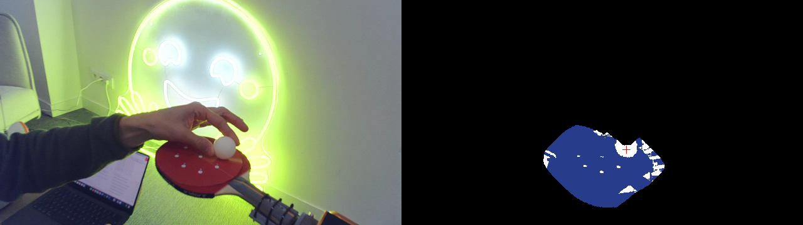
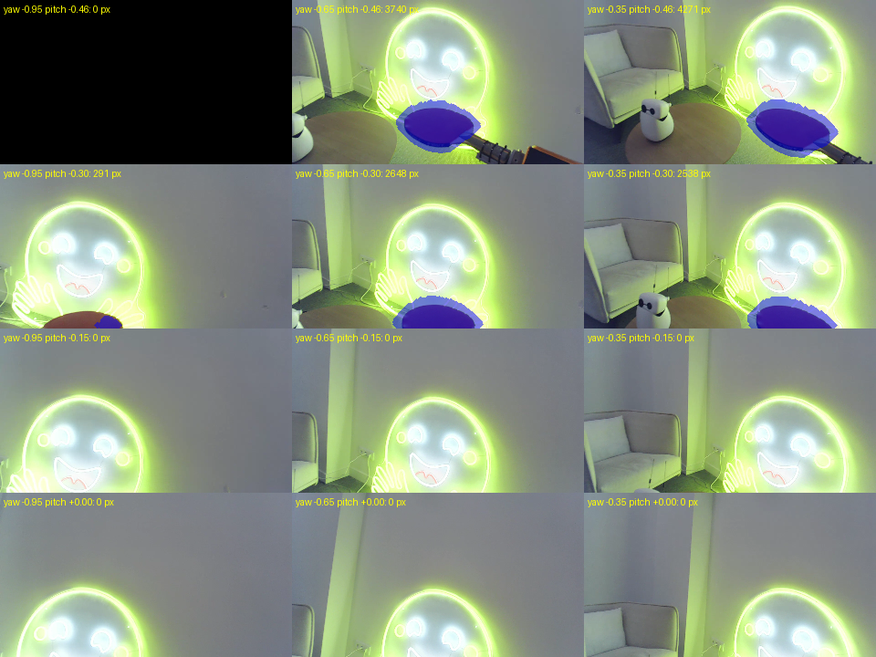

# Calibrating your Asimov 1

The policies see the ball through the head camera and a model of the arm, so they need to know **where "flat" is** for your
paddle and **where your camera is** on the head. About 30 minutes the first time, 5 minutes after a fall.

The `albert/*.json` files in this repository are Albert's calibrations: they are a starting point, not yours. Each script
below overwrites its file (the previous version goes to `albert/calibration_history/`).

## Before you start

- The robot **hangs from its gantry, rope taut** (every script asks for `--supported` to confirm it). E-Stop in reach.
- The paddle is in the printed holder on the right wrist cup, red side up; you have the white ball.
- `menlo setup` done on this computer (or run everything on the robot with `albert/onboard.sh`, same commands).
- Every script hands the robot back to Menlo's balance controller when it ends, on Ctrl+C or on an error.

| step | when | time | command | good result | writes |
|---|---|---|---|---|---|
| 1. Status | always first | 10 s | `python -m albert.status` | not faulted, joints < 60 C, camera image shown | — |
| 2. Joint directions | new robot | 1 min | `python -m albert.check_joints --supported` | each joint moves as announced | — |
| 3. Flat pose | new robot, new holder | 5 min | `python -m albert.teach_flat --supported` | poses agree within 3 deg | `arm_offset.json` |
| 4. Camera lens | once per robot (optional) | 5 min | `python -m albert.record_frames ...` then `calibrate_lens` | < 0.5 px rms | `camera_intrinsics.json` |
| 5. Camera on the head | new robot, **after every fall** | 5 min | `python -m albert.calibrate_camera --supported` | ~3 mm mean error | `camera_calibration.json` |
| 6. Camera aim | if the blade is cut off | 1 min | `python -m albert.aim_sweep --supported` | blade fully in view | `logs/aim_sweep.png` |
| 7. Camera latency | new robot, new computer | 1 min | `python -m albert.measure_latency --supported` | ~105 ms over Wi-Fi, less onboard | `camera_latency.json` |
| 8. Arm dynamics | only to retrain | 2 min | `python -m albert.sysid_arm_test --supported` then `tools.sysid_arm` | held-out error a few mrad | `arm_dynamics.json` |

## 1. Status (read-only)

```bash
python -m albert.status
```

Sends no motion. Checks the connection, mode, faults, temperatures, battery, arm angles, IMU, and takes one camera photo with
what the ball detector sees in it. If the robot's state goes to its own computer (`udp-state-host = 127.0.0.1`, see
[`albert/ONBOARD.md`](../albert/ONBOARD.md)), use `--mode livekit` from your laptop.

## 2. Joint directions (new robot)

```bash
python -m albert.check_joints --supported
```

Each of the 5 right-arm joints moves +0.15 rad and back while the script says where the hand should go. If one goes the
other way, set its entry of `ARM_SIGN` to -1 in `albert/common.py`. Albert needed no change.

## 3. Flat pose (new robot, new holder)

```bash
python -m albert.teach_flat --supported
```

The right arm goes limp (the rest of the robot holds its pose). Hold the paddle **flat, red side up** (check with a phone's
level app) in front of the robot and press Enter. Do it **3 times** at slightly different places, the first one where you
want the paddle while balancing. The script fits the 5 joint offsets that make all three poses flat. If it prints that the
poses do not agree (> 3 deg), redo it, holding the paddle flatter and stiller.

## 4. Camera lens (optional, once)

Improves the ball's position near the image edges; the camera's default model works without it.

```bash
python -m albert.record_frames --seconds 90 --every 0.5 --name checkerboard
uv run --with opencv-python-headless python -m albert.calibrate_lens data/<day>/checkerboard_<time>
```

Print [`data/checkerboard_9x6.png`](../data/checkerboard_9x6.png) on a stiff sheet. While recording, show it to the head
camera everywhere in the image (corners included), flat and tilted; with OpenCV installed the script tells you which parts
of the image are still uncovered.

## 5. Camera on the head (after every fall)

```bash
python -m albert.calibrate_camera --supported
```

Print [`albert/calibration_spots_A4.pdf`](../albert/calibration_spots_A4.pdf) at 100 % and mark its 9 spots on the paddle's
rubber with a pen: the centre, 4 cm towards the tip, the handle, left and right, and the four diagonals
([`albert/calibration_spots.png`](../albert/calibration_spots.png) shows the numbering). The arm levels the blade and the
head looks at it; put the ball on each spot when asked and press Enter. The script fits the camera's pose and focal length,
then checks itself on every spot: **~3 mm mean error** is good. Look at `albert/calibration_mask.png`: blue is where the
blade is searched, white the ball's colour, a red cross the detection; the ball must be the only white blob.



A fall usually shifts the camera or the neck's zero. If the camera no longer sees the paddle at all, set the neck's zero
again in Asimov Manager first, then run this step.

## 6. Camera aim (if the blade is cut off)

```bash
python -m albert.aim_sweep --supported
```

The neck sweeps a 4 x 3 grid; `logs/aim_sweep.png` shows each view with the blade outlined, and the script prints where the
blade is best seen next to the neck angles the run uses. No ball.



## 7. Camera latency

```bash
python -m albert.measure_latency --supported
```

The wrist wiggles for 6 s while the camera watches; the delay that lines up the blade in the images with the joint's motion
is the camera's latency. The ball predictor compensates for it. About 105 ms over Wi-Fi to a laptop, less on the robot's own
computer: measure it where you will run.

## 8. Arm dynamics (only to retrain)

```bash
python -m albert.sysid_arm_test --supported --log logs/C1_sysid_arm.csv      # ~70 s of gentle motion
python -m tools.sysid_arm logs/C1_sysid_arm.jsonl                              # fits delay, gains, damping, friction
```

The shipped policies were trained on Albert's arm. If yours behaves differently (the ball oscillates, the arm lags), fit
your arm and retrain on it: `train_albert.sh` reads `albert/arm_dynamics.json` (about 1 h on 32 CPU cores). The
MPC (`--controller mpc`) does not need retraining.

## Troubleshooting

| symptom | likely cause | fix |
|---|---|---|
| the ball is not found, or found off the paddle | camera moved, light changed | step 5; check `albert/calibration_mask.png` |
| the blade is cut off in the camera image | neck zero shifted | neck zero in Asimov Manager, then steps 6 and 5 |
| the ball always rolls to one side | flat pose off | step 3 |
| the paddle oscillates around the ball | camera latency or arm different from Albert's | step 7; try `--controller mpc`; step 8 and retrain |
| `ConnectError ... port 8851 already in use` | another script is connected to the robot | stop it (only one menlo-sdk process at a time) |
