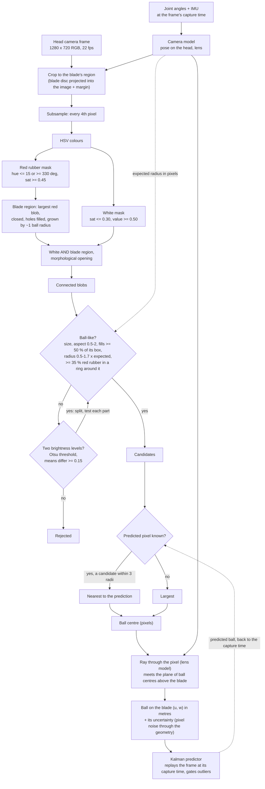

# Ball detector

Classical computer vision, no neural network: colour thresholds, connected blobs, shape tests, then the camera model.
Code: `detect()` in [`albert/ball_camera.py`](../albert/ball_camera.py); the hints come from
[`albert/run_policy.py`](../albert/run_policy.py) (`det_hints`).

## Why the split step

On 2026-11-20 (run M3) a neon sign behind the blade's far edge was bright and nearly colourless, so it passed the white test
inside the grown blade region. When the ball sat near that edge, its blob merged with the neon's into one large irregular
blob, which failed the shape test: the ball was missed in half the frames while balancing. The ball is much darker than a
light source, so splitting a failed blob at its brightness threshold separates them again. A light-grey floor behind the
blade did the same on 2026-11-19.

## Results (replaying the recorded detector videos offline)

| run | before | after |
|---|---|---|
| M3 (neon behind the blade), frames while balancing | 54 % | 96 % |
| 2026-11-19 (grey floor), all frames | 58 % | 65 % |
| B4, all frames | 96 % | 96 % (identical detections) |

Every changed detection was checked by eye: the new ones are the ball; the dropped or moved ones were highlights, fingers or
the paddle's handle. Cost: about +0.5 ms per whole frame on a Mac; on the robot only the blade's region is searched
(1.4 ms per frame on Albert's Pi before the change).

## Camera model

Pinhole projection, pixel = (fx * X / Z + cx, fy * Y / Z + cy) in the camera's frame, with OpenCV's lens distortion
(k1, k2, p1, p2, k3) when `albert/camera_intrinsics.json` exists (`albert/calibrate_lens.py`, from checkerboard frames).
The camera's pose on the head is fitted on 9 ball positions (`albert/calibrate_camera.py`); the head's pose comes from the
joint angles and the IMU.
